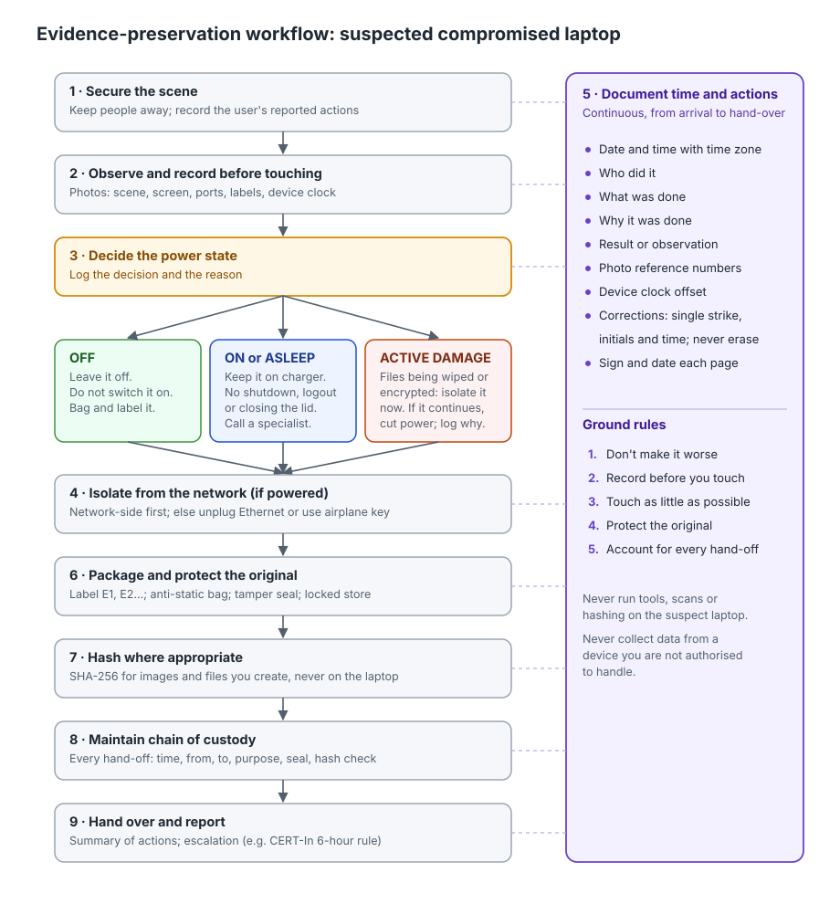

# Digital Evidence Preservation Workflow

**A safe first-responder workflow for a suspected compromised laptop, with a chain-of-custody template, a fictional worked example and a hands-on hashing demo.**

| | |
|---|---|
| **Intern** | Prathmesh Humane (Intern ID 2414) |
| **Programme** | RedKross Research Foundation Internship, October 2026 batch |
| **Task** | Digital Forensics Basics |
| **Explanatory video** | **[ADD YOUR VIDEO LINK HERE]** |

---

## Objective

The assigned task:

> Write a safe evidence-preservation workflow for a hypothetical compromised laptop. Cover recording observations, minimising unnecessary handling, documenting time and actions, protecting original evidence, hashes where appropriate, and chain of custody.

This repository answers it at **first-responder level**: what the first person on the scene (IT support, lab staff, a team lead) should do, and should *not* do, so that a trained examiner later receives evidence that is intact and fully documented.

## Deliverables

| Deliverable | Files |
|---|---|
| Evidence-handling guide | [`docs/evidence-handling-guide.md`](docs/evidence-handling-guide.md) · [PDF](docs/evidence-handling-guide.pdf) |
| Blank chain-of-custody template | [`templates/chain-of-custody-template.docx`](templates/chain-of-custody-template.docx) (editable) · [PDF](templates/chain-of-custody-template.pdf) (print) · [Markdown](templates/chain-of-custody-template.md) |
| Fictional worked example | [`docs/worked-example-fictional.md`](docs/worked-example-fictional.md) · [PDF](docs/worked-example-fictional.pdf) |
| Technical report | [`report/technical-report.md`](report/technical-report.md) · [PDF](report/technical-report.pdf) |
| Hashing demonstration | [`lab/hash-demo/`](lab/hash-demo/) |
| Test evidence | [`results/`](results/) |
| Video script | [`video/video-script.md`](video/video-script.md) |

## The workflow at a glance



1. **Secure the scene**: keep people away; record what the user says they did.
2. **Observe and record**: photograph and write down everything before touching anything.
3. **Decide the power state**: off stays off; on stays on (unless data is actively being destroyed).
4. **Isolate from the network**: at the switch or access point if possible, otherwise with the smallest physical action.
5. **Document time and actions**: a contemporaneous log with time zone and device clock offset, kept throughout.
6. **Package and protect the original**: label, bag, seal, store; analysis only on verified copies.
7. **Hash where appropriate**: SHA-256 for images and files you create or transfer, never by running tools on the live laptop.
8. **Maintain chain of custody**: every hand-off signed, with seal and hash checks.
9. **Hand over and report**: a written summary of what was and was not done; escalation.

## Repository structure

```text
digital-evidence-preservation-workflow/
├── README.md
├── docs/
│   ├── evidence-handling-guide.md / .pdf      # main guide
│   └── worked-example-fictional.md / .pdf     # end-to-end fictional case
├── templates/
│   └── chain-of-custody-template.docx / .pdf / .md
├── report/
│   └── technical-report.md / .pdf             # mandatory technical report
├── lab/
│   └── hash-demo/
│       ├── hash_demo.sh                       # safe SHA-256 demo (macOS/Linux)
│       ├── expected-hashes.sha256             # reference values
│       └── README.md
├── results/
│   ├── hash-demo-run-<timestamp>/             # demo output (logs, hashes, summary)
│   └── screenshots/
├── assets/
│   └── workflow-diagram.svg / .png
└── video/
    └── video-script.md
```

## How to use

**Responding to an incident.** Read the guide once beforehand. Keep the one-page checklist (guide Section 9) and printed custody forms in your response kit.

**Filling in custody forms.** Print `templates/chain-of-custody-template.pdf`, or fill in the `.docx`. Use one form per evidence item. Section 8 of the worked example shows a completed form.

**Running the hashing demo (macOS or Linux):**

```bash
git clone <this-repo-url>
cd digital-evidence-preservation-workflow/lab/hash-demo
chmod +x hash_demo.sh
EXAMINER="Your Name" ./hash_demo.sh
```

The script creates invented files, runs five integrity tests (reproducibility, read-only protection, verified copy, timestamp-only change, one-character tampering) and saves a timestamped, hash-sealed log under `results/`. See [`lab/hash-demo/README.md`](lab/hash-demo/README.md) for details and expected output.

## Safety and ethics

- **All data in this repository is fictional.** No real device was examined, and no data was collected from any person's device.
- IP addresses come from private (RFC 1918) and documentation-only (RFC 5737) ranges. Names, serial numbers, seal numbers and example hashes are invented.
- No passwords, keys, recovery keys or personal data are stored here. The guide instructs responders never to write recovery keys down.
- The demo script works only inside its own output folder and needs no network access or administrator rights.
- This material is for training. It is not legal advice and does not replace an organisation's incident-response policy or a qualified forensic examiner.

## Key references

- RFC 3227: Guidelines for Evidence Collection and Archiving (IETF, 2002)
- NIST SP 800-86: Guide to Integrating Forensic Techniques into Incident Response (2006)
- NIST IR 8387: Digital Evidence Preservation: Considerations for Evidence Handlers (2022)
- ISO/IEC 27037:2012: Guidelines for identification, collection, acquisition and preservation of digital evidence
- ACPO Good Practice Guide for Digital Evidence, v5 (2012)
- SWGDE Best Practices for Digital Evidence Collection (2018)
- NIST SP 800-61 Rev. 3 (2025); FIPS 180-4 (SHA-256)

Full citations are in the guide and the report.

## Author

**Prathmesh Humane**, Intern ID 2414
RedKross Research Foundation Internship, October 2026
